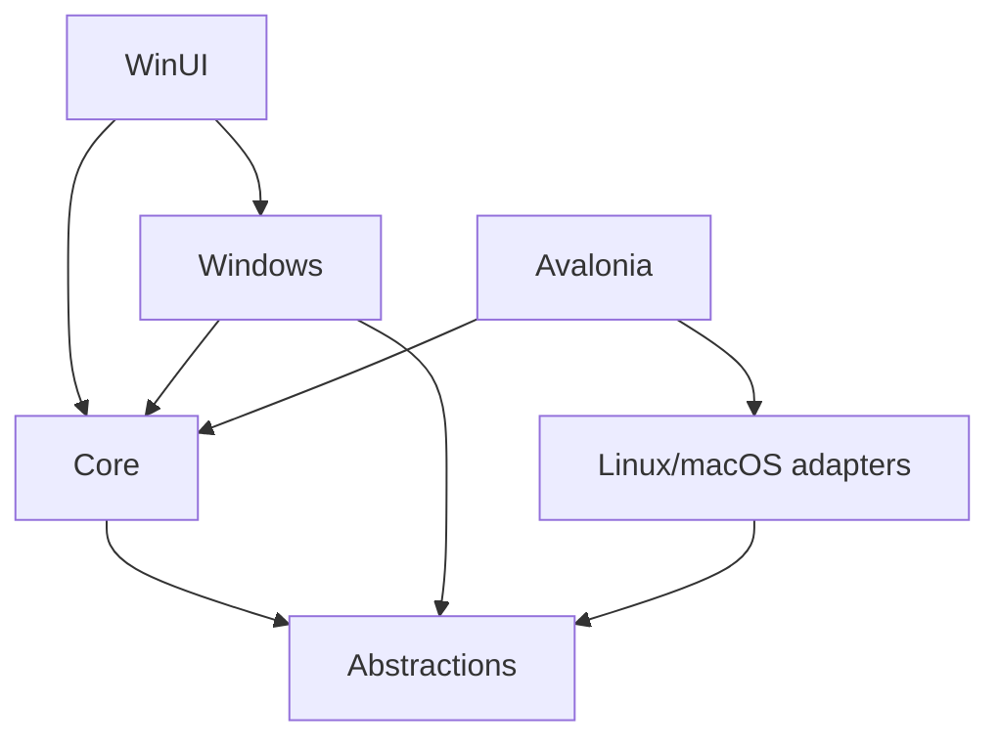

# Project structure

Directory and dependency migration: 2026-11-11.

```text
CMCLauncher.Core/
  Instances/          Instance models, discovery, migration and content
  Download/           Providers, HTTP transport, cache and parsing
  Launch/             Java, argument construction and game process orchestration
  Authentication/     Account protocols and credential-store facade
  Versions/           Game version classification
  Services/           Catalogs, tools, exports and application services
  Resources/          Shared language and theme JSON
CMCLauncher.Platform/
  Abstractions/       OS-neutral host contracts and safe portable defaults
  Windows/            Existing Windows implementation
  Linux/              Credentials, memory, Java discovery and trash
  MacOS/              Credentials, memory, Java discovery and trash
CMCLauncher.WinUI/
  Views/              Existing pages and main window
  Controls/           Existing WinUI controls
  ViewModels/         Reserved for incremental presentation-state extraction
CMCLauncher.Avalonia/  Linux/macOS desktop application and presentation state
CMCLauncher.Tests/
  Core/               Portable tests
  Windows/            Windows regression tests and common fixtures
```



The Core assembly targets `net8.0`, owns its embedded data resources, and cannot reference Windows APIs or either frontend. CA1416 remains an error. `CMCLauncher.Platform.Abstractions` contains no Core or UI references. The Core `LauncherPlatform` facade inherits portable defaults and retains domain-specific GPU settings orchestration for compatibility; the Windows implementation depends on Core but Core never depends on it.

Existing namespaces and assembly names are preserved, including `CMCLauncher.Platform.Windows`, so current settings and callers do not need a type-name migration. Paths to projects, embedded resources, CI tests, build helpers and package tooling use the new structure. Local build credentials now live in Git-ignored `.config/clientid.local.json` and `.config/curseforge.local.json`.

Avalonia provides desktop pages with shared session/task state. Java and frpc select platform assets and safely extract ZIP/TAR packages. Credentials use native stores. See [frontend notes](../CMCLauncher.Avalonia/README.md) for commands and remaining differences: Avalonia updates use separate OS/architecture assets and a staged worker; system telemetry uses platform adapters. Linux/macOS publication is cross-compilation evidence, not actual game execution.

Build and test from the repository root:

```text
dotnet build CMCLauncher.Core/CMCLauncher.Core.csproj -c Release
dotnet run --project CMCLauncher.Tests/Core/CMCLauncher.Core.Tests.csproj -c Release
dotnet run --project CMCLauncher.Tests/Windows/CMCLauncher.Tests.csproj -c Release
dotnet build CMCLauncher.WinUI/CMCLauncher.WinUI.csproj -c Release -p:Platform=x64 -r win-x64
```

Language files: `CMCLauncher.Core/Resources/Locales/`. Theme presets: `CMCLauncher.Core/Resources/Themes/`. WinUI still copies editable packs to `locales/` and `themes/` beside the application; the source move does not change published user-data paths.

Frontend selection is fixed by platform: Windows uses WinUI; Linux/macOS use Avalonia. Avalonia has no Windows adapter reference and rejects Windows publishing/execution. Windows build helpers and ZIP/EXE release jobs continue to target WinUI.
