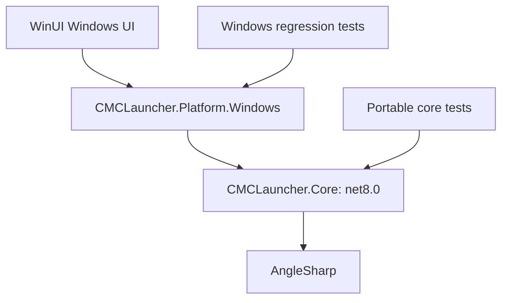

# Dependency and portability audit

Audited on 2026-11-05 using .NET SDK 8.0.425 on Windows x64. NuGet checks include direct and transitive packages from nuget.org. Machine-readable snapshots are in [audits/](audits/).

## Findings

- NuGet vulnerability and deprecation queries reported no affected packages in the restored application graph. This is a point-in-time advisory check, not proof that dependencies or the application are vulnerability-free. It does not audit bundled .NET/Windows native runtime code, downloaded Java/FRP executables, remote services, or HTML parsers' correctness.
- **Runtime migration is urgent:** .NET 8 support ends on 2026-11-10. The installed SDK currently publishes .NET 8.0.31 runtime assets; review the latest servicing/security release before distributing another build, then migrate the SDK, all projects, CI, trimming and packaging together to a supported LTS. This extraction deliberately keeps the existing framework to avoid mixing an SDK migration with the assembly boundary change. See Microsoft's [support policy](https://dotnet.microsoft.com/en-us/platform/support/policy) and [end-of-support notice](https://devblogs.microsoft.com/dotnet/dotnet-8-9-end-of-support/).
- The outdated query found newer Markdig, Windows App SDK and several transitive packages (see the snapshot). Do not independently upgrade tightly coupled Windows App SDK component packages based solely on the largest version number. Validate the supported component combination and WinUI activation, resource deployment, trimming and single-file cold start together.
- JSON reflection and COM produce IL2026 trimming warnings. Core and Windows adapter assemblies are explicitly rooted in the WinUI publisher, retaining the previous preserve-application-code policy. This is not a NativeAOT-safe or fully trim-safe core. Source-generated JSON contracts and a separate COM boundary remain follow-up work.
- Embedded CurseForge developer keys remain recoverable from distributed binaries. Moving them into Core changes the containing assembly, not their security properties. Existing build injection and package/log hygiene remain required; no real key is included in this report or fixtures.
- No package lock file is used. Direct package versions are pinned; transitive resolution should be reviewed when changing the SDK or packages. The snapshots record what was resolved during this audit, not a locked dependency graph.

## Resolved packages and license metadata

License identifiers below are read from the installed NuGet manifests, not inferred from package names. Component packages with license files retain their own distribution terms. Consult each package's full terms and notices before redistribution; this table is not a legal compatibility opinion.

| Package | Resolved version | Relationship | NuGet license metadata |
| --- | --- | --- | --- |
| Markdig | 1.4.2 | Direct / SDK | BSD-2-Clause |
| Microsoft.NET.ILLink.Tasks | 8.0.31 | Direct / SDK | MIT |
| Microsoft.WindowsAppSDK.DWrite | 1.8.25122902 | Direct / SDK | Package license file: license.txt |
| Microsoft.WindowsAppSDK.WinUI | 1.8.260803003 | Direct / SDK | Package license file: license.txt |
| AngleSharp | 1.9.1 | Transitive | MIT |
| Microsoft.Web.WebView2 | 1.0.3179.45 | Transitive | Package license file: LICENSE.txt |
| Microsoft.Windows.SDK.BuildTools | 10.0.26100.4654 | Transitive | Package-specific terms |
| Microsoft.Windows.SDK.BuildTools.MSIX | 1.7.20250829.1 | Transitive | Package license file: sdk_license.txt |
| Microsoft.WindowsAppSDK.Base | 1.8.251216001 | Transitive | Package license file: license.txt |
| Microsoft.WindowsAppSDK.Foundation | 1.8.260803002 | Transitive | Package license file: license.txt |
| Microsoft.WindowsAppSDK.InteractiveExperiences | 1.8.260708001 | Transitive | Package license file: license.txt |

AngleSharp 1.9.1 is the only direct third-party dependency of `CMCLauncher.Core` (MIT, managed HTML DOM parsing). Markdig stays in the WinUI presentation layer (BSD-2-Clause). Windows App SDK, DWrite, WebView2, build tools and ILLink do not become dependencies of Core.

## Build and release tooling

The repository has no JavaScript package manifest or application Python dependency set. Release mirroring uses `boto3==1.40.65` through `scripts/sync-release-s3.py`; its transitive dependencies are not locked and were not covered by the NuGet vulnerability query. CI uses `actions/checkout@v4`, `actions/setup-dotnet@v4`, `actions/upload-artifact@v7`, `actions/download-artifact@v8`, `actions/setup-python@v5` and `softprops/action-gh-release@v2`. These are mutable major-version tags rather than immutable commit pins. Pinning reviewed action commits and auditing the Python release environment are separate supply-chain follow-ups. None of these tools is linked into Core.

## Assembly boundary



`CMCLauncher.Core/CMCLauncher.Core.csproj` owns domain models, storage, networking, authentication protocols, downloads, resource providers, archives, version rules and UI-independent theme/localization catalogs. It contains no P/Invoke, registry calls, WinUI/WinRT types or Windows SDK reference. CA1416 is an error, and a reflection-based regression check rejects native imports and Windows assembly references.

`native/CMCLauncher.csproj` retains its path for existing scripts but now produces `CMCLauncher.Platform.Windows.dll`. It provides DPAPI, memory/region queries, Java registry discovery, GPU registry preferences and the PowerShell updater. Both the Windows application and Windows regression entry point install `WindowsLauncherPlatform` before accessing services. A future non-Windows host references Core directly and supplies its own `LauncherPlatform` implementation. Configure once at startup; it is process-wide host state, not per-request state.

Without a secure credential adapter, Core refuses to encrypt/decrypt online credentials; it never falls back to plaintext. Offline identity data requires no credential store. Automatic memory allocation falls back to 2048 MB if no memory capability is supplied; manual memory remains available. GPU integration defaults to a no-op, and Java registry discovery defaults to an empty sequence.

Core embeds the existing built-in theme, language packs and optional build-time authentication resources, retaining their logical resource names. Editable theme/locale files remain copied by WinUI. The source JSON files currently live under `winui/` and are referenced as data inputs, so building Core from a source subset must include those files. Core does not require compiling WinUI or installing the Windows SDK. Namespace `CMCLauncher` is preserved to limit public API churn.

## Portability status and remaining work

| Area | Current status / required follow-up |
| --- | --- |
| HTTP, CMS parsing/cache/rate limiting, blueprint metadata/downloads | Portable Core; existing fixture suites run without a Windows adapter |
| Mojang OS rules and native classifier selection | Use current `windows`, `linux` or `osx`; architecture matching follows the current process |
| Java discovery | Host executable name and PATH separator; Windows registry paths supplied by adapter. Expand Linux/macOS system JDK discovery next |
| Java automatic download | Existing Windows x64 ZIP pipeline retained; explicitly rejected on other platforms before network access. Needs platform/architecture asset selection, tar handling and executable permissions |
| FRP distribution/process startup | Existing Windows x64 assets retained; explicit platform guard. Needs Linux/macOS archives and permission handling |
| Game launch and loaders | Managed implementation extracted, but **not certified on Linux/macOS**. Validate native extraction, permissions, loader installers, argument expansion and actual games on each OS/architecture |
| File paths, migration and archives | Existing conservative Windows naming rules and case-insensitive comparisons remain in several managers; audit case-sensitive volumes, symlinks and platform-specific directory ownership before shipping another OS |
| Credentials | Windows DPAPI unchanged; Linux secret service / macOS Keychain adapter required. Windows-encrypted credentials must not be copied as if portable |
| Updates | Windows adapter still validates Windows packages and invokes PowerShell; other hosts need their own updater |
| UI and file pickers | WinUI, shell/recycle-bin integration, rendering and native dialogs remain Windows-only; no replacement frontend selected in this change |

## Reproducing verification

```text
dotnet build CMCLauncher.Core/CMCLauncher.Core.csproj -c Release
dotnet run --project core.tests/CMCLauncher.Core.Tests.csproj -c Release
dotnet run --project native.tests/CMCLauncher.Tests.csproj -c Release
dotnet build winui/CMCLauncher.WinUI.csproj -c Release -p:Platform=x64 -r win-x64
dotnet list winui/CMCLauncher.WinUI.csproj package --include-transitive --vulnerable
dotnet list winui/CMCLauncher.WinUI.csproj package --include-transitive --deprecated
```

The portable test runner reuses the CMS and blueprint protocol/cache/download regression suites, and checks assembly isolation, credential failure behavior, injected memory services, embedded resources, OS rules and Java path handling. CI adds Windows, Ubuntu and macOS jobs for this runner; release packaging depends on all three plus the existing Windows regression suite.

Local execution was on Windows only: no WSL/Linux runtime or macOS host was available. Linux x64 and macOS ARM64 RID builds are compilation evidence, not actual execution on those systems. The new CI matrix must execute there before claiming runtime support. Windows checks also cover the trimmed self-contained publisher and the existing blueprint UI verification; build outputs remain under `.artifacts/` and do not replace `dist`.

### Local verification results

- Portable Core checks and both reused HTTP regression suites: passed on Windows without the Windows adapter.
- Existing Windows regression runner: all 69 groups passed.
- Blueprint UI verification on a trimmed self-contained build: 23 checks passed, no `failure.txt`.
- Linux x64 and macOS ARM64 RID compilation: passed; no native OS execution claimed.
- Windows self-contained publish and release archive sensitive-file scan: passed.
- Build-time CurseForge configuration injection into Core: passed using a synthetic, non-secret key; original resource name retained.
- Single-file isolated cold-start activation and warm-start preservation of locale/FRP edits: passed.

Logs and isolated builds are under `.artifacts/core-*` and `.artifacts/core-split-*`; no `dist` files were overwritten.
